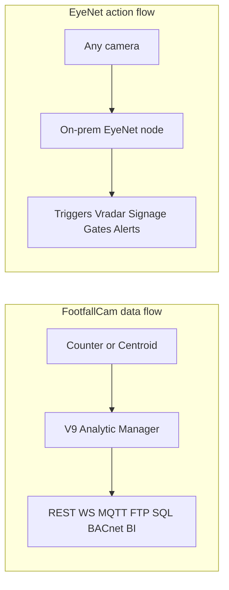

# EyeNet vs FootfallCam — Feature Comparison Matrix

**Date:** 23 Oct 2026  
**Scope:** Public marketing claims and published API/knowledge-base docs for FootfallCam; EyeNet claims from in-repo value and invest content, plus product-team notes on work in development (called out explicitly). This is not a lab bake-off or penetration test of either product.

**Cell legend:** `Yes` · `Partial` · `No` · `Different` · `WIP` (in development) · `Not documented` (absent from cited EyeNet sources — do not treat as a confirmed gap in the shipping product)

---

## Positioning

| | **EyeNet** | **FootfallCam** |
|---|---|---|
| **Category** | On-prem edge vision + operational action (Presence, Gate, Signage, Vradar, Sentinel, Matrix) | People-flow / space analytics platform (hardware counters + V9 Analytic Manager) |
| **Primary buyer outcome** | Detect → decide → act on site (alerts, signage, gates, care/security events); video stays local | Measure visitors, occupancy, queues → BI and ops workflows (roster, checkout, washroom, marketing ROI) |
| **Hardware model** | Any IP, Wi‑Fi, or mobile camera on a ~16 GB PC; no per-camera licenses | Own people counters + Centroid 64 (RTSP/ONVIF on existing CCTV); UK-designed hardware + software |

EyeNet sells sovereignty and real-time action on ordinary cameras across six documented use-case markets. FootfallCam sells precision footfall measurement, multi-industry space analytics, and a mature data-export stack into BI and facility systems.

---

## 1. Vertical markets

Ordered by EyeNet’s six documented use cases first, then additional FootfallCam industry pages where EyeNet has no matching named wedge.

| Vertical market | EyeNet | FootfallCam | Notes / sources |
|---|---|---|---|
| **1. HR / workplace Presence** | **Yes** — entrance stations, Vprofile, Presence apps, remote WFH; HubSpot-first CRM | **No** as HR attendance product (office pages are occupancy / portfolio, not check-in) | EN: `value/why/hr-presence/index.html`, `invest/addendum-a/index.html`, `invest/where-it-pays/index.html`. FFC: Offices industry |
| **2. Vision-adaptive Intelligent Signage** | **Yes** — age, gender, group size → playlist switching; impressions, dwell, footfall-to-sales | **Different** — Marketing ROI Tracker on footfall events; not vision-driven screen content switching | EN: `value/content/why-mall-en.html`, what-functionalities, addendum-a. FFC: V9 Apps |
| **3. Family / cottage protection** | **Yes** — intrusion, unknown person, presence check, local footage, phone alerts | **No** | EN: `value/why/cottage/index.html`, invest where-it-pays |
| **4. Home care / Virtual Ward** | **Yes** — caregiver presence, zones, fall, voice help-call; tokenized events to clinical stack (Talos / TMAIX / ePokratis) | **No** | EN: `value/why/home-care/index.html`, invest where-it-pays |
| **5. Night / perimeter security** | **Yes** — guard vigilance, perimeter Presence, Vradar, forensics; Event Security Lite | **No** (not a security product framing) | EN: `value/why/security/index.html`, B2C packages |
| **6. Shipping & industrial** | **Yes** — restricted zones, shift/contractor presence, PPE-aware alerts, onboard headcount, Matrix thin-link / degraded queue | **No** (partner stats cite buses/public transport footfall, not shipboard ops) | EN: `value/content/why-shipping-en.html`. FFC: homepage partner stats |
| Retail stores / malls (ops analytics) | **Partial** — covered via Signage + Gate + Retail Compliance Lite; not a footfall-BI suite | **Yes** — primary market; tenant-mix, campaign ROI, staffing | EN: packages, why-mall. FFC: homepage |
| QSR / supermarket queues | **Not documented** as queue product | **Yes** — queue counting, Checkout Manager | FFC: homepage + V9 |
| Washrooms / cleaning ops | **Not documented** | **Yes** — Washroom Cleaning app + industry page | FFC: homepage + V9 Apps |
| Offices / hybrid real estate (desk utilisation) | **Partial** — Presence / capacity; not desk-utilisation suite | **Yes** — offices industry; Space Occupancy | EN: Presence. FFC: homepage + V9 |
| Airports / museums / libraries / universities / smart cities | **Not documented** as named industries | **Yes** — dedicated industry pages | FFC: homepage |
| Exhibitions / events | **Partial** — Event Security Lite | **Yes** — exhibitions industry (IN/OUT, dwell, peaks) | EN: B2C packages. FFC: homepage |
| Wearables / drones (Sentinel) | **Yes** — camera glasses + drones for VIP / bodyguard teams (cross-cuts security) | **No** | EN: addendum-a |

---

## 2. Architecture & deployment

| Capability | EyeNet | FootfallCam | Notes / sources |
|---|---|---|---|
| Edge / on-device processing | **Yes** — on-device AI; complete on-premises deployment | **Yes** — processing at the edge; data masked at source | EN: `value/content/what-functionalities-en.html`. FFC: [footfallcam.com](https://www.footfallcam.com/) “Privacy by Design” |
| Video must leave the premises | **No** — “video that never has to leave the site”; zero video cloud | **Different** — analytics pipeline to V9 (cloud / private cloud / on-prem); privacy framed as no PII collected/stored, not “video stays forever local” | EN: `invest/content/eyenet-investor-primer.html`, `invest/what-changes/index.html`. FFC: homepage + V9 Security/Privacy |
| Full offline operation | **Yes** — full functionality without internet | **Partial** — edge counters operate locally; Analytic Manager / cloud features and many exports assume connectivity | EN: `what-functionalities-en.html`, `value/innovation/index.html`. FFC: device retention + central server model in [Chapter 13](https://www.footfallcam.com/people-counting/knowledge-base/chapter-13-data-flow/) |
| On-prem server hosting | **Yes** — default posture | **Yes** — On-Prem Server installation (V9) | EN: what-functionalities. FFC: [V9 Software Suites Features](https://www.footfallcam.com/Product/FootfallCam-Software-Suites-Features) Servers |
| Storage connectivity (on-prem or cloud) | **Yes** — separate storage module; supports any connectivity option for storage (default on-prem or cloud services) | **Different** — V9 hosting choices (on-prem / private cloud / FootfallCam cloud) for analytics data, not a pluggable storage-module framing | EN: product note (storage module). FFC: V9 Servers |
| Private cloud hosting | **Partial** — via storage-module connectivity to cloud services; processing remains edge/on-prem by default | **Yes** — Private Cloud Installation | EN: product note. FFC: V9 Servers table |
| Vendor cloud hosting | **Different** — not sold as a camera-cloud VMS; optional cloud *storage* via storage module | **Yes** — FootfallCam Cloud Server (complimentary option) | EN: `value/innovation/index.html` + product note. FFC: V9 Servers |
| Works with existing IP cameras | **Yes** — any IP / Wi‑Fi / mobile camera | **Yes** — Centroid 64 via RTSP/ONVIF (Hikvision, Dahua, Axis, etc.); also proprietary counters | EN: what-functionalities. FFC: [Centroid 64 Integration](https://www.footfallcam.com/Product/FootfallCam-Centroid-64-Integration) |
| Hardware floor | **Yes** — ~16 GB RAM + modern CPU; no GPU farm required | **Different** — dedicated counters / Centroid appliance in server-room style deployments | EN: what-functionalities, `invest/the-bet/index.html`. FFC: Centroid page |
| Per-camera licenses | **No** — no per-camera licenses; scale hardware-bound | **Not stated** as “no per-camera” in cited pages; product sold as counters + V9 Lite/Enterprise suites | EN: what-functionalities. FFC: V9 Lite vs Enterprise feature matrix |
| Multi-site / fleet ops | **Yes** — Matrix dashboard; VPN fleets (Enterprise) | **Yes** — multi-site V9 aggregation, site/branch cubes | EN: `invest/addendum-a/index.html`, `value/packages/enterprise/index.html`. FFC: V9 + [V9 Server API](https://www.footfallcam.com/people-counting/knowledge-base/v9-server-api/) |

---

## 3. People & space analytics

| Capability | EyeNet | FootfallCam | Notes / sources |
|---|---|---|---|
| In/out (entrance) counting | **Yes** — Gate: counts people in and out; people counting | **Yes** — In/Out Counting (V9) | EN: what-functionalities, `invest/addendum-a/index.html`. FFC: V9 People Counting Metrics |
| Live occupancy | **Yes** — occupancy / capacity thresholds; real-time dashboards | **Yes** — Live Occupancy | EN: what-functionalities. FFC: V9 |
| Area / zone / polygon counting | **Yes** — restricted zones, virtual perimeters, multi-camera zones | **Yes** — Area Counting | EN: what-functionalities, why/security. FFC: V9 |
| Group / “buying group” counting | **Not documented** | **Yes** — Group Counting | FFC: V9 |
| Staff exclusion from counts | **Not documented** as dedicated counting filter | **Yes** — Staff Exclusion (5 methods); WebSocket `PeopleTypeId` visitor vs staff | FFC: V9; Chapter 13 WebSocket payload |
| Child / age-band filter & automation | **Yes** — instant detection yields age; triggers and automations compare against age results (child and other age bands) | **Yes** — Child Filter (enable/disable counting of children) | EN: product note + what-functionalities (demographic trigger conditions). FFC: V9 Child Filter |
| Demographics (age, gender) | **Yes** — demographic analysis; Signage and triggers use age, gender, group size | **Yes** — Facial Demographic Analysis (gender, age group, emotions, etc.) | EN: what-functionalities, `value/content/why-mall-en.html`. FFC: V9 |
| Emotions | **Not documented** | **Yes** — listed under Facial Demographic Analysis | FFC: V9 |
| Dwell / route tracking | **Yes** (shipping) — 3D route / dwell in docs; **WIP** Route Behavioural Configurator (see below) | **Yes** — dwell via area metrics; Heat Dwell MQTT payloads | EN: what-functionalities. FFC: Chapter 13 MQTT Heat Dwell |
| Behavioural route analytics (paths, known-body re-ID) | **WIP** — Route Behavioural Configurator in development; expected ship **mid November 2026**. Worker computes people movements from body-detection input and identifies known bodies by cross-validating face recognition on the same route position / camera / time plane — enabling FootfallCam-class behavioural analytics on EyeNet | **Yes** — heatmaps, heat dwell, area behaviour metrics shipping today | EN: product-team note (Oct 2026). FFC: V9 Heatmap + Chapter 13 |
| Heatmap (floorplan hot/cold) | **WIP** — targeted via Route Behavioural Configurator (mid Nov 2026); not a separate shipping heatmap product today | **Yes** — Heatmap metric + MQTT heatmap every 15 min (50×50 grid) | FFC: V9; Chapter 13 |
| Queue metrics (length, wait, serve) | **Not documented** as a product feature | **Yes** — Queue Counting | FFC: V9; homepage industries (airports, QSR, supermarket) |
| Space / desk / meeting-room occupancy | **Partial** — occupancy / capacity for premises and zones; not sold as desk-utilisation suite | **Yes** — Space Occupancy (rooms, open areas, desks) | EN: what-functionalities. FFC: V9 |
| Face / POI / watchlist | **Yes** — known-face whitelists, threat watchlists, Sentinel POI; same face plane feeds WIP route known-body cross-validation | **Different** — demographics for analytics; not positioned as security POI/VIP stack | EN: what-functionalities, addendum-a. FFC: V9 demographics |
| Intrusion / unauthorised presence | **Yes** — cottage/security wedges | **No** (not a security product framing) | EN: `value/why/cottage/index.html`, `value/why/security/index.html` |
| Fall / voice help-call | **Yes** — home care / Virtual Ward | **No** | EN: `value/why/home-care/index.html` |
| PPE / lone-worker | **Yes** — optional / industrial claims | **No** | EN: what-functionalities, `value/content/why-shipping-en.html` |
| Guard vigilance | **Yes** — night/perimeter security | **No** | EN: `value/why/security/index.html` |
| Attendance / Presence check-in | **Yes** — Presence: face + QR/NFC | **Different** — occupancy/footfall, not HR attendance product | EN: addendum-a, `value/why/hr-presence/index.html` |

**Route Behavioural Configurator (WIP):** EyeNet is building a worker that (1) derives people-movement / route behaviour from body-detection streams and (2) resolves known bodies by cross-validating face recognition against the same route position, camera, and time plane. Once shipped (target mid November 2026), this closes the behavioural-analytics gap versus FootfallCam’s heat/dwell/path style metrics while remaining on-prem and trigger-ready.

---

## 4. Action & automation

| Capability | EyeNet | FootfallCam | Notes / sources |
|---|---|---|---|
| Rule engine / thresholds / alerts | **Yes** — Vradar; per-camera triggers; AND/OR; historical comparison; multi-camera correlation | **Yes** — Rule Engine; Checkout Manager alerts; Application Pod thresholds | EN: what-functionalities, addendum-a. FFC: V9 Customisation + Apps |
| Age / demographic trigger conditions | **Yes** — triggers and automations compare against age (and other demographic) results from instant detection — child and other age bands | **Partial** — Child Filter and demographics feed analytics/apps; not framed as per-camera age-gated action fabric | EN: product note + what-functionalities (“person count thresholds, demographics…”). FFC: V9 |
| Mobile / email / SMS notifications | **Yes** — push, in-app, email, SMS via integrations | **Partial** — ops alerts via apps/rules; not framed as consumer-style push stack | EN: what-functionalities. FFC: V9 Apps / Rule Engine |
| Slack / Microsoft Teams workflows | **Yes** — dedicated Slack and Teams workflows, configured in simple user settings | **Not documented** on cited public pages | EN: product note (workflows). FFC: V9 Integration / Apps |
| General workflow connections | **Yes** — general workflow connectors via the same simple user-settings model (alongside Slack/Teams) | **Partial** — Application Pod / custom rules; not a user-settings workflow gallery framing | EN: product note + what-functionalities (custom workflows). FFC: V9 Custom Pod / Rule Engine |
| Vision-driven digital signage | **Yes** — Signage product; playlist automation from demographics/behaviour | **No** as core product (marketing ROI on footfall events, not screen content switching) | EN: what-functionalities, why-mall. FFC: Marketing ROI Tracker app |
| Retail ops apps (roster, checkout, washroom) | **Not documented** as packaged apps | **Yes** — Staff Roster Planner, Checkout Manager, Washroom Cleaning, Sales Tracker, Marketing ROI, Location Analysis | FFC: V9 Apps |
| Predictive / AI analytics workspace | **Partial** — behavioural patterns, historical comparison triggers; WIP route behavioural worker | **Yes** — Predictive Analysis, AI Analytics Workspace, Pivot Grid, Dashboard Builder | EN: what-functionalities + WIP note. FFC: V9 Apps / Customisation |
| Webhooks → access control / HVAC / third parties | **Yes** — webhook actions to external systems | **Partial** — Device API via REST, Webhook, Web Socket for data; BACnet for BMS counting | EN: what-functionalities. FFC: V9 Integration; Chapter 13 BACnet/WebSocket |
| Gates / physical control actions | **Yes** — triggers fire gates; Gate product | **Different** — checkout open/close *alerts*, not physical gate control as core claim | EN: invest what-changes, addendum-a. FFC: Checkout Manager |
| Multi-site Matrix + VPN remote | **Yes** — Matrix; secure VPN remote access | **Partial** — multi-site V9; Remote Device Login for support | EN: enterprise package, what-functionalities. FFC: V9 Support |

---

## 5. Privacy & security

| Capability | EyeNet | FootfallCam | Notes / sources |
|---|---|---|---|
| Edge privacy / masking | **Yes** — all processing and storage on-premises; complete data sovereignty | **Yes** — edge processing; live-view privacy mask; “no PII captured or stored”; GDPR compliance claim | EN: what-functionalities. FFC: homepage + V9 Security and Privacy |
| Video sovereignty (footage never forced to cloud) | **Yes** — core thesis; care uses tokenized events only | **Different** — emphasizes no PII / masked analytics over local video vault positioning | EN: home-care, cottage, investor primer. FFC: V9 GDPR row |
| SSL / encrypted transport | **Yes** — encrypted, access-controlled, VPN-ready | **Yes** — SSL 256-bit | EN: what-functionalities. FFC: V9 |
| RBAC | **Yes** — role-based permissions; Enterprise SSO/RBAC | **Yes** — Role based Account Access Control | EN: what-functionalities, enterprise package. FFC: V9 Account Management |
| SSO / Active Directory | **Yes** (Enterprise audience requirement) | **Yes** — SSO + Active Directory (V9) | EN: `value/packages/enterprise/index.html`. FFC: V9 |
| Backup / restore policy | **Not documented** in cited pages | **Yes** — Backup and Restore Policy | FFC: V9 |
| Accuracy audit / tuning service | **Not documented** | **Yes** — Accuracy Audit by specialists | FFC: V9 Support |
| Remote diagnostics without video exfil | **Yes** — “Remote diagnostics without compromising security” | **Yes** — Remote Device Login for support | EN: what-functionalities. FFC: V9 Support |

---

## 6. Data integration & API

| Integration surface | EyeNet | FootfallCam | Notes / sources |
|---|---|---|---|
| Full documented REST API (OpenAPI / Swagger) | **Yes** — complete API documented via OpenAPI specs and Swagger | **Partial** — device + server APIs documented in KB/Developer Hub; not framed as a full OpenAPI/Swagger product surface on cited pages | EN: product note (OpenAPI/Swagger). FFC: Chapter 13, Developer Hub, V9 Server API |
| Device / platform REST for counts & events | **Yes** — covered by the OpenAPI-documented platform API (not a counter-cgi model) | **Yes** — legacy `apiCount.cgi` + Pro2 2025 `/v1/auth/login` + `/v1/data/counting` (second/minute/hour); device retention 7 days fine / 30 days hourly | EN: product note. FFC: [Chapter 13](https://www.footfallcam.com/people-counting/knowledge-base/chapter-13-data-flow/) |
| Analytic Manager / server export API | **Different** — EyeNet platform OpenAPI rather than Analytic Manager export centre | **Yes** — Settings → Export API; site/counter aggregation; hourly/daily | EN: product note. FFC: Chapter 13 |
| V9 cube / SQL API (server) | **Not documented** | **Yes** — cube.footfallcam.com REST/SQL; site/area measures | FFC: [V9 Server API](https://www.footfallcam.com/people-counting/knowledge-base/v9-server-api/) |
| WebSocket live IN/OUT | **Not documented** (webhooks for *actions*) | **Yes** — topic `ffc-eventrawdata`; client must ACK `OK`; ~10k event buffer | FFC: Chapter 13 |
| MQTT (device push) | **Not documented** | **Yes** — 3D Pro2: occupancy, counting, heat dwell, heatmap, point cloud | FFC: Chapter 13 |
| FTP push (counter or server) | **Not documented** | **Yes** — daily/weekly CSV/XLSX; counter-level and branch-level | FFC: Chapter 13 |
| SQL Server functions | **Not documented** | **Yes** — e.g. `GetBranchHourly`, `GetBranchDailySummary`, `GetAreaHourly`, `GetCounterByBranch` | FFC: Chapter 13 |
| BACnet | **Not documented** | **Yes** — In-C-X / Out-C-X last 48 hours | FFC: Chapter 13 |
| BI connectors (Power BI, Tableau) | **Not documented** as native connectors | **Yes** — V9 BI System Connectors | FFC: V9 Integration |
| Manual CSV/Excel download | **Partial** — reports/digests claimed; export format not specified in-repo | **Yes** — manual download / email Excel/CSV | EN: why pages (digests). FFC: V9 |
| CRM / eHealth / SIEM | **Yes** — HubSpot-first; Enterprise ERP/CRM/eHealth/SIEM; care tokenized clinical events | **No** as named eHealth/SIEM stack | EN: hr-presence, enterprise, home-care |
| Third-party datasets (weather, economic, population, ePOS, staff, store) | **Partial** — footfall-to-sales funnel for signage; not a third-party data marketplace | **Yes** — Weather, Economic, Population Density, Sales, Staff, Store Data (V9) | EN: why-mall. FFC: V9 Third Party Data Set |
| Data Manager / client DB ingest | **Not documented** | **Yes** — FootfallCam Data Manager | FFC: V9 Integration |
| Historical migrate from incumbent counters | **Not documented** | **Partial** — migrate into Analytic Manager; “not available for public release” without sales contact | FFC: Chapter 13 |

---

## Where each wins

**EyeNet wins when the buyer needs:**
- The six use-case markets FootfallCam does not cover as products: HR Presence, vision-adaptive Signage, family/cottage, Virtual Ward / eHealth, night security, shipping/industrial (plus Sentinel wearables)
- On-prem vision that **acts** — including age-band triggers from instant detection (child and other ages) → signage, gates, alerts, Slack/Teams and general workflows from simple user settings
- A full OpenAPI/Swagger-documented platform API, plus a separate storage module that can target on-prem or cloud storage backends
- Video sovereignty and offline operation by default (homes, care, ships, thin-link sites), without locking storage to a single cloud
- No per-camera license ceiling; one fabric (Presence / Gate / Signage / Vradar / Sentinel / Matrix)
- Behavioural route analytics parity with footfall-style path/dwell metrics via the Route Behavioural Configurator (**WIP**, expected mid November 2026)

**FootfallCam wins when the buyer needs:**
- Purpose-built retail/facility people-flow measurement shipping today (queues, staff exclusion, group counting, heatmaps, desk/space occupancy)
- Packaged ops apps (roster, checkout, washroom, marketing ROI, sales tracker)
- A published, multi-protocol data plane (device REST, WebSocket, MQTT, FTP, SQL, BACnet, BI cubes) for enterprise BI and BMS

**Overlap (fair, not identical):** both claim edge processing, in/out and occupancy-style metrics, demographics, multi-site reporting, REST/webhook-class integration, and GDPR-minded privacy — but EyeNet optimizes for real-time vision actions across six vertical markets and sovereignty; FootfallCam optimizes for measured footfall → BI and facility workflows.

---

## Source appendix

### EyeNet (local)

| Path | Role |
|---|---|
| [`value/content/what-functionalities-en.html`](../../value/content/what-functionalities-en.html) | Primary feature inventory |
| [`value/what/index.html`](../../value/what/index.html) | Built “What is EyeNet” |
| [`value/innovation/index.html`](../../value/innovation/index.html) | Differentiation vs cloud |
| [`value/packages/b2c/index.html`](../../value/packages/b2c/index.html) · [`b2b`](../../value/packages/b2b/index.html) · [`enterprise`](../../value/packages/enterprise/index.html) | Packaging |
| [`value/why/`](../../value/why/) · [`value/content/why-*-en.html`](../../value/content/) | Six use-case markets |
| [`invest/content/eyenet-investor-primer.html`](../../invest/content/eyenet-investor-primer.html) | Investor framing |
| [`invest/addendum-a/index.html`](../../invest/addendum-a/index.html) | Six products |
| [`invest/the-bet/index.html`](../../invest/the-bet/index.html) · [`invest/what-changes/index.html`](../../invest/what-changes/index.html) · [`invest/where-it-pays/index.html`](../../invest/where-it-pays/index.html) | Architecture & wedges |

Product-team notes in this brief (Route Behavioural Configurator; age-band triggers from instant detection; OpenAPI/Swagger API; Slack/Teams/general workflows via user settings; separate storage module) are not yet fully mirrored in the HTML sources above.

### FootfallCam (public)

| URL | Role |
|---|---|
| [https://www.footfallcam.com/](https://www.footfallcam.com/) | Homepage, industries, privacy-by-design |
| [https://www.footfallcam.com/Product/FootfallCam-Software-Suites-Features](https://www.footfallcam.com/Product/FootfallCam-Software-Suites-Features) | V9 Lite/Enterprise feature matrix |
| [https://www.footfallcam.com/Product/FootfallCam-Centroid-64-Integration](https://www.footfallcam.com/Product/FootfallCam-Centroid-64-Integration) | RTSP/ONVIF / existing CCTV |
| [https://www.footfallcam.com/people-counting/knowledge-base/chapter-13-data-flow/](https://www.footfallcam.com/people-counting/knowledge-base/chapter-13-data-flow/) | API / export / WebSocket / MQTT / FTP / SQL / BACnet |
| [https://www.footfallcam.com/people-counting/knowledge-base/v9-server-api/](https://www.footfallcam.com/people-counting/knowledge-base/v9-server-api/) | Server cubes / REST & SQL API |
| [https://www.footfallcam.com/Resources/DeveloperHub](https://www.footfallcam.com/Resources/DeveloperHub) | Developer Hub overview |

---

## Appendix: FootfallCam only — company, clients, GTM & financials

**Scope:** FootfallCam-only public data (not an EyeNet comparison block). Comparison tables above always list **EyeNet first**, then FootfallCam.

**Finding:** No public venture / PE funding rounds were identified for **FootfallCam** (the 2002 UK people-counting company). Aggregators and the company’s own knowledge-base describe it as privately held, bootstrapped / self-funded, with **zero external financing** and **zero debt**. Client, pricing, and financial figures below are from public marketing pages and third-party databases; they are not audited by EyeNet.

### Investment rounds (FootfallCam)

| Round / event | Date | Amount | Investors | Status |
|---|---|---|---|---|
| External VC / PE rounds | — | — | — | **None found** in public sources |
| Tracxn stage | — | — | — | **Unfunded** — “has not raised any funding rounds yet” |
| PitchBook | — | — | — | Profile lists **Private**; no funding rounds in public preview |
| Company self-statement | Ongoing | N/A (organic reinvestment) | Founders / retained earnings | “**no outstanding debts and external financing**”; “**zero debt** and without any external financing such as (overdrafts, loans, debentures, mortgage, leasing, etc.)” |

Sources: [Tracxn — FootFallCam](https://tracxn.com/d/companies/footfallcam/__mu6MA_wd4d9N4s2V49qrdZDmdtRSG3tMZu7BrNnoV6c); [PitchBook — FootfallCam](https://pitchbook.com/profiles/company/470722-42); [FootfallCam KB — Chapter 2: Company Profile](https://www.footfallcam.com/people-counting/knowledge-base/chapter-2-company-profile/) (§3.0 Financial and Operational Performance; §7.2 Financial Stability).

### Legal entity & ownership (public registries)

| Item | Public data |
|---|---|
| UK company | **FOOTFALLCAM UK LIMITED** — Companies House no. **04471557** |
| Incorporated | June 2002 |
| Status | Private limited company |
| Significant controllers / shareholders | **Edward Wong** (50%) and **Sheau Wen Kao** (50%) — ordinary shares |
| HQ (registry / commercial) | Guildford, UK (Pomanda / LinkedIn); Tracxn also lists Bridgend, UK |
| Ops footprint (self-described) | UK and Malaysia operation centres |

Sources: [Companies House — 04471557](https://find-and-update.company-information.service.gov.uk/company/04471557); [Pomanda — footfallcam uk limited](https://pomanda.com/company/04471557/footfallcam-uk-limited); [UK GlobalDatabase](https://uk.globaldatabase.com/company/footfallcam-uk-limited); FootfallCam Chapter 2.

### FootfallCam only — typical clients & installation characteristics

FootfallCam’s public positioning is **B2B people-flow hardware + V9 analytics** for commercial and public venues — not consumer / home / care. Installations centre on **entrance counters** (Pro2) and optional **Centroid** appliances that reuse existing CCTV for area / journey analytics.

#### Scale & segment mix (marketing claims)

| Claim | Number / detail | Source |
|---|---|---|
| Businesses supported (with partners) | **30,000+** | [footfallcam.com](https://www.footfallcam.com/) |
| Named “global clients” (customer stories) | **500+** clients; “**tens of thousands** of counters” worldwide | [Customer Stories](https://www.footfallcam.com/Resources/CustomerStories) |
| Retailers helped | **2,200+** (claimed sales lift 3–8%) | Homepage partner stats |
| Mall operators | **1,200+** (claimed rental revenue lift 10–15%) | Homepage |
| Offices / real-estate | **500+** (claimed portfolio cost cut ~18%) | Homepage |
| Bus / public transport | **150+** operators | Homepage |
| Client spectrum | Small independent retailers → large global chains; shopping malls; public venues & institutions | Customer Stories |
| Example retail brands cited | L’Occitane, Bonmarché, Gant, Levi’s, Reebok, Crocs (and others on reference pages) | Customer Stories / references |
| Industries on site | Retail, shopping malls, offices, smart cities, libraries, washrooms, museums, airports, food / QSR, supermarkets, exhibitions, universities | Homepage industries |

#### Typical installation pattern

| Characteristic | Public description |
|---|---|
| Core hardware | **Pro2** (or similar) people counters at **entrances** — often 1–2 units for a single retail door set |
| In-store / area analytics | Reuse **existing CCTV** via **Centroid** (RTSP/ONVIF) for zones, heatmaps, shopper journey — e.g. retail “Enterprise” package cites **1× Pro2 + 4× CCTV + 1× Centroid** |
| Mall / large site | Multiple entrance Pro2 units + Centroid on existing cameras; washroom kits (**3D Mini + Mesh Hub**) on higher mall packages |
| Who installs | FootfallCam **installation network**, customer’s **own contractor**, or **self-install** with remote positioning guidance (customer stories describe minimal on-site FootfallCam labour) |
| Accuracy / setup | Counters auto-calibrate environment; optional paid **Accuracy Audit** tuning service |
| Software bundle | Analytic Centre / V9 reporting (daily/weekly store & company reports, conversion, heatmaps, zone analytics, health check, export/integration) |
| Warranty / support (buy page) | **1-year** manufacturer hardware warranty; local distributor support; 24/7 monitoring & helpdesk claims on How to Buy |

#### Published “starting at” package sizes (illustrative — still sales-led)

| Segment | Essentials | Standard | Enterprise |
|---|---|---|---|
| **Retail stores** | **$550** — 1× Pro2 at entrance | **$1,100** — 2× Pro2 | **$1,700** — 1× Pro2 + Centroid on ~4 existing CCTV |
| **Shopping malls** | **$3,300** — Pro2 at entrances | **$9,500** — Pro2 + Centroid for key areas / occupancy | **$9,970** — above + washroom usage / cleaning alerts |

Sources: [Retail Pricing](https://www.footfallcam.com/Industries/RetailPricing); [Shopping Mall Pricing](https://www.footfallcam.com/Industries/ShoppingMallPricing); [How to Buy](https://www.footfallcam.com/Home/HowToBuy); [Centroid 64](https://www.footfallcam.com/Product/FootfallCam-Centroid-64-Integration). Currency as shown on site (USD starting prices); local distributors quote in local currency. Pages still push **customised plans** and contact / partners for real projects.

### Business model & go-to-market

| Dimension | **EyeNet** | **FootfallCam** |
|---|---|---|
| Primary motion | **Full ladder:** B2C Light (freemium / self-serve) → B2B Starter & Professional (sales-assisted) → Enterprise (strategic) | **Contact / consultative sales** only — demo, pilot, quote via sales or certified local reseller; no public self-serve checkout |
| How to buy | Web signup / app-first for Light; sales-assisted land-and-expand for B2B; custom contracts for Enterprise | [How to Buy](https://www.footfallcam.com/Home/HowToBuy): (1) Consultancy with country sales rep → (2) Planning / quotation (stores, floor plans) → (3) Purchase via **local certified distributor** → (4) Installation & support |
| Buyer persona | Homes, SMBs, multi-site ops, care, security, industrial — buying **edge vision that acts** (Presence, Gate, Signage, Vradar, etc.) | Store / mall / facility / estate operators buying **people-counting systems** |
| Offer shape | Software (and optional hardware-agnostic cameras) packaged as **monthly / event** SKUs; no per-camera licenses | Hardware counters + Centroid + V9 software / apps; “starting at” packages then **custom pricing** |
| Channel | Direct + partner channels (e.g. HubSpot-first CRM; eHealth partners Talos / TMAIX) documented in value/invest | Global **reseller / distributor** network (“global-domestic” local partners) |
| Consumer / B2C | **Yes** — B2C Light | **Not offered** as a packaged consumer product |
| Mid-market B2B | **Yes** — Starter & Professional | Yes — retail/mall packages via sales |
| Enterprise | **Yes** — $5,000+/mo, Matrix, VPN fleets, custom integrations | Yes — custom bids, multi-site, V9 Enterprise feature tier |

#### EyeNet commercial packages (documented)

| Tier | Model | List / plan bands | Sources |
|---|---|---|---|
| **B2C Light** | Freemium + self-serve · free funnel **60–90 days** → Lite / Pro | Signage Lite **$30–100/mo**; Home Security Lite **$20–50/mo**; Retail Compliance Lite **$50–100/mo**; Event Security Lite **$200–1,200/event**; overall **$20–300/mo** band | [`value/packages/b2c/index.html`](../../value/packages/b2c/index.html) |
| **B2B Starter** | Sales-assisted SaaS | **$500–1,000/mo** · 1–5 locations · 5 cameras · single app | [`value/packages/b2b/index.html`](../../value/packages/b2b/index.html) |
| **B2B Professional** | Sales-assisted SaaS | **$1,500–3,000/mo** · 5–20 locations · 25 cameras · multi-app · ACV path ~**$12–36K/year** | same |
| **Enterprise** | Strategic / custom | **$5,000+/mo** · unlimited locations/cameras · Matrix · VPN fleets · ERP/CRM/eHealth/SIEM · contract band often **$6K–$150K+/year** | [`value/packages/enterprise/index.html`](../../value/packages/enterprise/index.html) |

#### FootfallCam commercial packages (public “starting at” — still contact-led)

| Tier | Retail starting | Mall starting | Path to purchase |
|---|---|---|---|
| Essentials / Standard / Enterprise | $550 / $1,100 / $1,700 | $3,300 / $9,500 / $9,970 | Contact sales (`sales@footfallcam.com`), phone, WhatsApp, or local partner — [Contact](https://www.footfallcam.com/Home/Contact), [How to Buy](https://www.footfallcam.com/Home/HowToBuy) |

**GTM contrast (one line):** FootfallCam monetises a **hardware-led, sales-and-reseller** people-counting system; EyeNet monetises a **software-led B2C → B2B → Enterprise package ladder** on cameras the customer already owns (or soft cameras), with self-serve entry that FootfallCam does not publish.

### FootfallCam only — five-year public financials (FOOTFALLCAM UK LIMITED)

Entity: **04471557** · Years ended **26 December** · Accounts type: **Unaudited abridged** (filed at [Companies House](https://find-and-update.company-information.service.gov.uk/company/04471557/filing-history)).

**Caveats:** Abridged micro/small accounts often **omit statutory turnover**. Where turnover / P&L appears below from [Pomanda](https://pomanda.com/company/04471557/footfallcam-uk-limited), those lines are **Pomanda estimates** derived from Companies House filings — not a company-stated revenue disclosure. Balance-sheet cash / net assets / current assets & liabilities are from aggregator extracts of filed accounts ([CompanyCheck](https://companycheck.co.uk/company/04471557/FOOTFALLCAM-UK-LIMITED/companies-house-data), [CompanyPulse](https://www.companypulse.co.uk/company/04471557/footfallcam-uk-limited), [Endole](https://open.endole.co.uk/insight/company/04471557-footfallcam-uk-limited)). Figures are GBP; not audited by EyeNet.

#### Balance sheet (filed / aggregator extracts) — last five years

| Metric | YE 26 Dec **2020** | YE 26 Dec **2021** | YE 26 Dec **2022** | YE 26 Dec **2023** | YE 26 Dec **2024** |
|---|---:|---:|---:|---:|---:|
| Cash | £862,873 | £822,999 | £1,008,890 | £888,627 | £1,443,504 |
| Total current assets | £4,596,606 | £4,178,293 | £4,769,337 | £5,420,778 | — |
| Total assets | — | — | — | £5.43m (Endole) | £5,966,418 |
| Total current liabilities | £598,050 | £155,954 | £17,364 | £20,656 | — |
| Total liabilities | — | — | — | — | £33,887 |
| Net assets / net worth | £3,576,454 | £3,597,432 | £4,450,136 | £5,253,668 | £5,932,531 |
| Employees (UK filing) | 6 | 7 | 6 | 6 | 6 |

YoY net-assets change (approx.): **+0.6%** (2020→21) · **+23.7%** (2021→22) · **+18.1%** (2022→23) · **+12.9%** (2023→24). Cash trough in 2021, rebound through 2024.

Sources: CompanyCheck (2020–2023 cash, net worth, current assets/liabilities); CompanyPulse iXBRL summary (2024 total assets, net assets, cash, liabilities, employees); Endole (2023 total assets); Pomanda (employee counts aligned to Dec years).

#### Estimated profit & loss (Pomanda) — five years through YE 2023

| Metric | YE Dec **2019** | YE Dec **2020** | YE Dec **2021** | YE Dec **2022** | YE Dec **2023** |
|---|---:|---:|---:|---:|---:|
| Turnover (est.) | £4,279,708 | £6,667,524 | £6,306,716 | £7,030,081 | £8,727,613 |
| Gross profit (est.) | £1,750,093 | £2,779,997 | £2,719,373 | £2,965,056 | £3,695,399 |
| Operating profit (est.) | £1,320,432 | £1,343,385 | £23,791 | £956,632 | £1,090,720 |
| Pre-tax profit (est.) | £1,326,752 | £1,344,302 | £25,899 | £988,890 | £1,140,529 |
| Profit after tax / retained (est.) | £1,074,669 | £1,088,885 | £20,978 | £800,839 | £855,397 |
| Employees | 6 | 6 | 7 | 6 | 6 |

Notes on the series: estimated turnover roughly **doubled** from 2019→2023 (~£4.3m → ~£8.7m). **2021** shows a sharp estimated operating-profit dip (~£24k) then recovery in 2022–23. A free public **Pomanda-style P&L estimate for YE 2024** was not available at research time; filed 2024 abridged accounts (CompanyPulse) still show **turnover unreported**.

Source: [Pomanda — FOOTFALLCAM UK LIMITED financials](https://pomanda.com/company/04471557/footfallcam-uk-limited) (Companies House + Pomanda Estimates).

#### Other scale indicators (not in the five-year tables)

| Metric | Figure | Source / caveat |
|---|---|---|
| Employees (aggregator / LinkedIn-style) | **115–118** | Tracxn / LinkedIn — likely group or broader count; **do not equate** to the UK filing figure of ~6 |
| Annual revenue (LinkedIn commercial profile) | ~**USD 20m** | LinkedIn company financials field — unaudited / third-party; may include non-UK operations |
| Outstanding charge | **1** reported on Endole | Contrast with company KB claim of “zero debt” — charge ≠ necessarily bank debt; verify on Companies House charges register |

*(Client / install counts are detailed under **FootfallCam only — typical clients & installation characteristics** above.)*

### FootfallCam only — staff & partner ecosystem

| Claim / metric | Figure / detail | Confidence |
|---|---|---|
| Employees on UK filings (FOOTFALLCAM UK LIMITED) | **~6** most years; ~**9** in latest Endole YE 2025 extract | **High** — statutory accounts |
| Est. UK-entity turnover (YE 2023) | ~**$11M** (£8.7m × ≈$1.27) | Medium — Pomanda estimate |
| Employees (About page marketing) | “**Over 200**” at HQ and regional offices | **Low for FTE** — see note |
| Engineers (About page marketing) | “**80+** experienced engineers” + PhDs | **Low for FTE** — see note |
| Aggregator headcount (Tracxn / LinkedIn-style) | ~**115–118** | Medium — not UK statutory |
| Partner roles | Authorised resellers; technology / regional distributors; system / enterprise integrators; installation specialists; deployment partners; consultants; nationwide field-service partners | High as role list |
| Deployments | **200+ countries**; **10,000+ locations**; **30,000+ businesses** with partners | Marketing claims |
| Exact reseller / distributor headcount | **Not published** | — |

#### Gentle note — headcount vs financials

The About-page **200+ employees / 80+ engineers** claim is difficult to reconcile with the UK entity’s public accounts. At ~$11M estimated turnover, 200 FTEs would imply only ~**$55k revenue per employee** — thin for a hardware + analytics vendor — and a UK-costed payroll of that size would likely exceed the filed P&L. The statutory UK headcount (~**6–9**) and staff-cost scale fit a small UK core (with possible Malaysia / offshore delivery outside that filing). Treat **200+ / 80+** as a **marketing or blended group framing** (or partner capacity), **likely overstated as direct FTE** relative to the published UK financials, until a consolidated group disclosure appears. Prefer filed UK headcount for financial triangulation; the channel (“global-domestic” partners) may explain a large share of field capacity customers experience.

Sources: [About](https://www.footfallcam.com/Home/About); [Companies House / CompanyPulse / Endole](https://find-and-update.company-information.service.gov.uk/company/04471557); [Partnerships](https://www.footfallcam.com/Partner/Partnerships); [Partner Program](https://www.footfallcam.com/Partner/PartnerProgram); [Distributors](https://www.footfallcam.com/Partner/Distributors); [Authorised Resellers](https://www.footfallcam.com/Partner/AuthorisedResellers).

### Name collision — do not conflate with FootFall Ltd (2000)

A **£5m** syndicate round in **April 2000** for **FootFall Ltd** (founded 1991 by John Gallagher and Brian Barnes; investors included NewMedia SPARK, Quester, Advent Venture Partners, Abbey National Treasury Services) is a **different company**. It is frequently confused in search results with FootfallCam but is **not** FootfallCam UK Limited (2002).

Source: [Investegate RNS — “10% Stake Taken in FootFall Ltd” (17 Apr 2000)](https://www.investegate.co.uk/announcement/rns/rockwood-strategic--rkw/10-stake-taken-in-footfall-ltd-/172379).

### Implications for competitive framing

FootfallCam’s public posture is a **long-running private bootstrap** (est. 2002) with a **mature installed base** (500+ named clients, tens of thousands of counters, 30,000+ businesses via partners) sold through **contact sales and local distributors** — not a venture-backed, self-serve PLG peer. Feature depth comes from retained earnings and R&D reinvestment. EyeNet’s contrast is both **product** (action + six vertical markets) and **GTM** (B2C Light freemium → B2B → Enterprise packages). Compare capital strategy and package ladder accordingly when positioning EyeNet’s seed motion against FootfallCam’s reseller-led install model.
