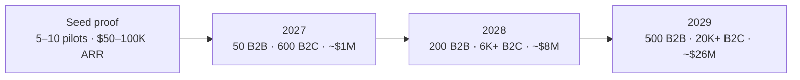
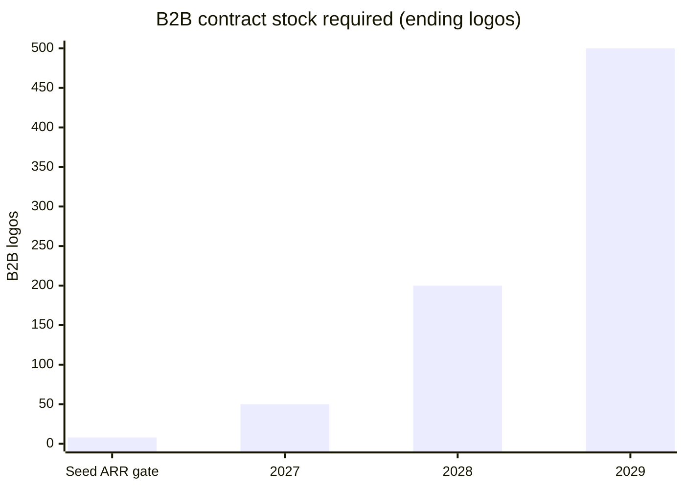
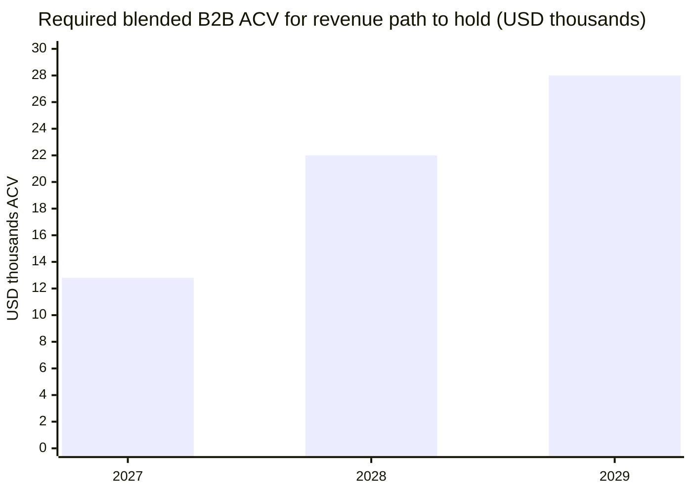

# Financial Prerequisites

**Purpose.** Expected contract and logo results from marketing and sales so the plan financials hold.  
**Bases:** `pricing-and-revenue-estimations.md` and `use-of-proceeds-study.md` (both derived from `invest/`).

**Rule.** Seed size ($500K / $1M / $2.5M) changes **how fast** GTM stands up — not CAC, LTV, or payback. Financials hold only if **logo counts, ARR gates, retention, and blended ACV** track the path below.

---

## 1. What “holding” means

The plan holds if both layers are met:

1. **Commercial proof gates** (use of proceeds / seed ladder)  
2. **Revenue × customer counts** (pricing / Addendum A path)

| Horizon | Contracts / logos required | ARR / revenue required | Implied deal shape |
|---------|----------------------------|------------------------|--------------------|
| **In-seed (base $1M proof)** | **5–10 pilots** · **50-lead pipeline** · **2–3 partners** | **$50–100K ARR** | Early B2B; mostly Starter-like |
| **End 2027** | **50 B2B** + **~600 paying consumers** | **~$1M** | Blended B2B ACV **~$12.8K** + B2C @ **~$50 MRR** |
| **End 2028** | **200 B2B** + **6,000+ consumers** | **~$8M** (breakeven) | Blended B2B ACV **~$22K** |
| **End 2029** | **500 B2B** + **20,000+ consumers** | **~$26M** | Blended B2B ACV **~$28K** |
| **Series A narrative** | Path toward **~200 customers** | Sales + marketing ramp | Same unit economics |

Those ACVs come from the pricing doc’s **derived mix check** (B2C at ~$50 MRR peeled off first). They must stay inside Starter/Pro **~$12–36K** and Enterprise “often **$12–20K+**.”

---

## 2. Contract scoreboard

### 2.1 Seed window — minimum for the ladder to be “true”

On the **base** path, in-seed marketing/sales must produce:

| Result | Why it matters |
|--------|----------------|
| **5–10 live pilots / early contracts** | Commercial proof, not demo theater |
| **$50–100K ARR** | At ~$12–13K ACV ≈ **4–8 paying B2B**; at Starter mid ~$9K ≈ **6–11** |
| **50 qualified leads in pipeline** | Enough to staff Series A story |
| **2–3 channel partners live** | De-risks getting to ~50 logos |

**Burn ($500K)** only asks for launch + first pilots (no acceleration layer).  
**Accelerate ($2.5M)** must hit the **same economics earlier** (denser sales + London), not a higher ACV model.

### 2.2 2027 — first year financials hold

**Must have on the books:**

| Book | Count | Revenue (derived) | What “a contract” looks like |
|------|------:|------------------:|------------------------------|
| B2B (Starter/Pro/Ent mix) | **50** | **~$640K** | Avg **~$12.8K ACV** ≈ **~$1,070/mo** → mostly **Starter**, few Pro |
| B2C paid | **~600** | **~$360K** | **~$50 MRR** after freemium |
| **Total** | | **~$1M** | |

**Net new after seed:** if seed ends at 5–10 B2B, you still need roughly **+40–45 B2B contracts** in the period into 2027, plus **~600 paid B2C**.

### 2.3 2028 — breakeven year (hardest step-up)

| Book | Ending count | YoY net logos | Revenue (derived) | Deal quality bar |
|------|-------------:|--------------:|------------------:|------------------|
| B2B | **200** | **+150** stock | **~$4.4M** | Avg ACV must rise to **~$22K** (more Pro / light Enterprise / wearables) |
| B2C | **6,000+** | **~+5,400** | **~$3.6M** | Still ~$50 MRR blend |
| **Total** | | | **~$8M** | |

With **85–90% B2B retention**, also replace churn:

- Churn on the path from ~50 → 200 ≈ **5–8** logos lost early, then more as the base grows  
- Rough order: **~160–180 new B2B contracts** in the 2027→2028 window to **end at 200** (not just +150 ignoring churn)

Series A language (“path toward ~200 customers”) is essentially **this 2028 B2B stock**.

### 2.4 2029 — $26M holds only if mix richens

| Book | Ending count | YoY net logos | Revenue (derived) | Deal quality bar |
|------|-------------:|--------------:|------------------:|------------------|
| B2B | **500** | **+300** stock | **~$14M** | Avg ACV **~$28K** (Pro-heavy + Enterprise + premiums) |
| B2C | **20,000+** | **~+14,000** | **~$12M** | Volume motion stays cheap CAC |
| **Total** | | | **~$26M** | |

With 10–15% annual churn on a growing book, **new B2B logos needed** are closer to **~320–350** in that step, not 300.

*Seed bar ≈ midpoint of 4–11 logos implied by $50–100K ARR at ~$9–13K ACV.*

---

## 3. What marketing spend must “buy” (CAC capacity)

Use-of-proceeds **marketing program** residuals (planning split) vs pricing CAC:

| Seed | Marketing programs (approx.) | If spent at B2C CAC $20–30 | If spent at Enterprise CAC $3–5K |
|------|-----------------------------:|---------------------------:|--------------------------------:|
| Burn | ~$97K | ~3.2K–4.9K B2C logos *capacity* | ~19–32 Ent logos *capacity* |
| Base | ~$274K | ~9K–14K B2C | ~55–90 Ent |
| Accelerate | ~$698K | ~23K–35K B2C | ~140–230 Ent |

Reality for the P&L is a **blend**:

- **2027 consumers (600)** are cheap: at $25 CAC ≈ **$15K** of CAC — a small slice of even burn marketing.  
- **2027’s 50 B2B** are the scarce object: sales-assisted, 3–4 mo payback, not $25 CAC.  
- **2028–29** need marketing to feed **both** high B2C volume **and** a 50-lead→AE machine that upgrades ACV from ~$13K → ~$22K → ~$28K.

So for financials to hold, marketing is not “spend the bucket”; it is:

1. Fill **50 → pipeline → AE** for B2B  
2. Convert freemium → **paid B2C at ~$50 MRR**  
3. Support **land-and-expand** so average B2B contract value rises each year  

---

## 4. Sales capacity vs required contracts (from FTE study)

Derived GTM headcount in use-of-proceeds:

| Seed | Sales FTE (derived) | CS FTE | Implied job for financials |
|------|--------------------:|-------:|----------------------------|
| Burn | **0.5** | — | First pilots only |
| Base | **1.0** | — | Close into **$50–100K ARR** + build **50-lead** book |
| Accelerate | **4.5** | **1.0** | Parallel pilots; compress time to **~50 B2B / ~$1M** and toward **~200** |

Illustrative productivity bar (derived, not printed in `invest`):

- **1 AE** sustaining the base path toward **50 B2B by 2027** ≈ on the order of **~3–5 new logos/month** once ramped (plus partner-sourced).  
- **4.5 Sales FTE** on accelerate must **parallelize** that same logo math earlier — same ACV/CAC rules.

Partners (**2–3** in-seed) are part of the contract machine; without them, AE capacity alone is tighter.

---

## 5. One-page expected-results checklist

| Stage | Expected contract results |
|-------|---------------------------|
| **Seed (base)** | 5–10 pilots · **$50–100K ARR** · 50 leads · 2–3 partners |
| **2027** | **50 B2B contracts** @ ~**$13K** blended ACV · **600** paid B2C @ ~**$50 MRR** · **~$1M** total |
| **2028** | **200 B2B** @ ~**$22K** ACV · **6,000+** B2C · **~$8M** · retention **85–90%** |
| **2029** | **500 B2B** @ ~**$28K** ACV · **20,000+** B2C · **~$26M** |
| **All seeds** | Same CAC/LTV/payback; accelerate only **front-loads** the same contract curve |

### Failure modes that break the financials

Even if activity looks busy, financials miss if:

- Lots of pilots but **ARR &lt; $50K** in-seed  
- 50 logos but **ACV stuck &lt;&lt; $12K** (cannot make $1M with 600 B2C alone)  
- Hit logo counts but **churn &gt; 10–15%** (never reach 200/500 stock)  
- B2C CAC blows past **$20–30** or paid conversion fails (2028–29 consumer revenue collapses)  
- Mix never richens (ACV stuck at Starter) → **$8M / $26M** miss even at 200/500 logos  

---

## 6. Bottom line

Marketing and sales must deliver a **rising B2B contract book (50 → 200 → 500)** with **rising blended ACV (~$13K → ~$22K → ~$28K)**, plus a **self-serve consumer book (600 → 6K → 20K)** at **~$50 MRR**, gated first by **5–10 pilots and $50–100K ARR** in the seed window.

Extra seed capital buys **speed and capacity** (more marketing $, more AE/SE FTEs, footprint) — not a different contract economics story.

---

*Companion docs: `pricing-and-revenue-estimations.md`, `use-of-proceeds-study.md`.*
