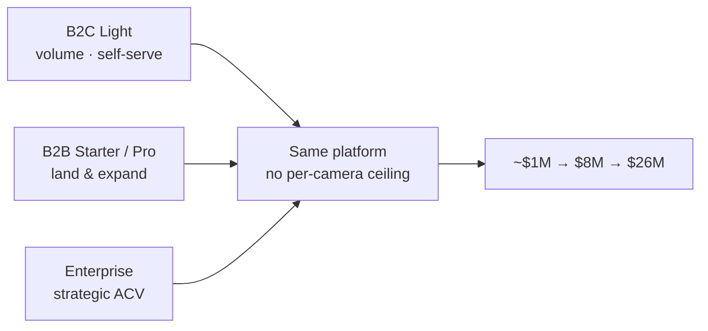
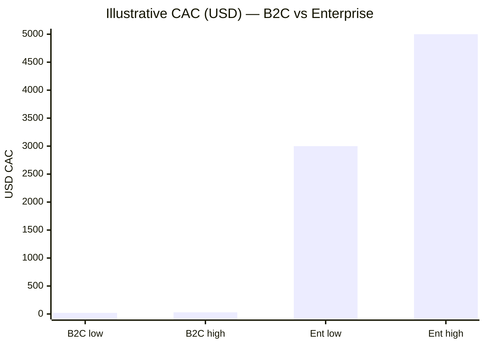
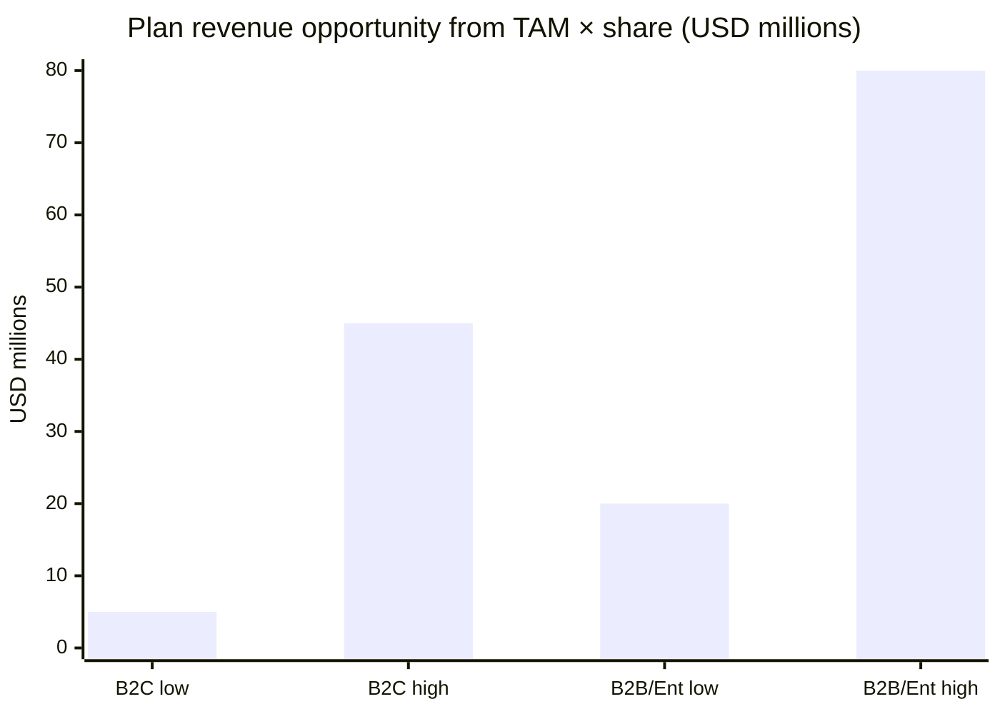
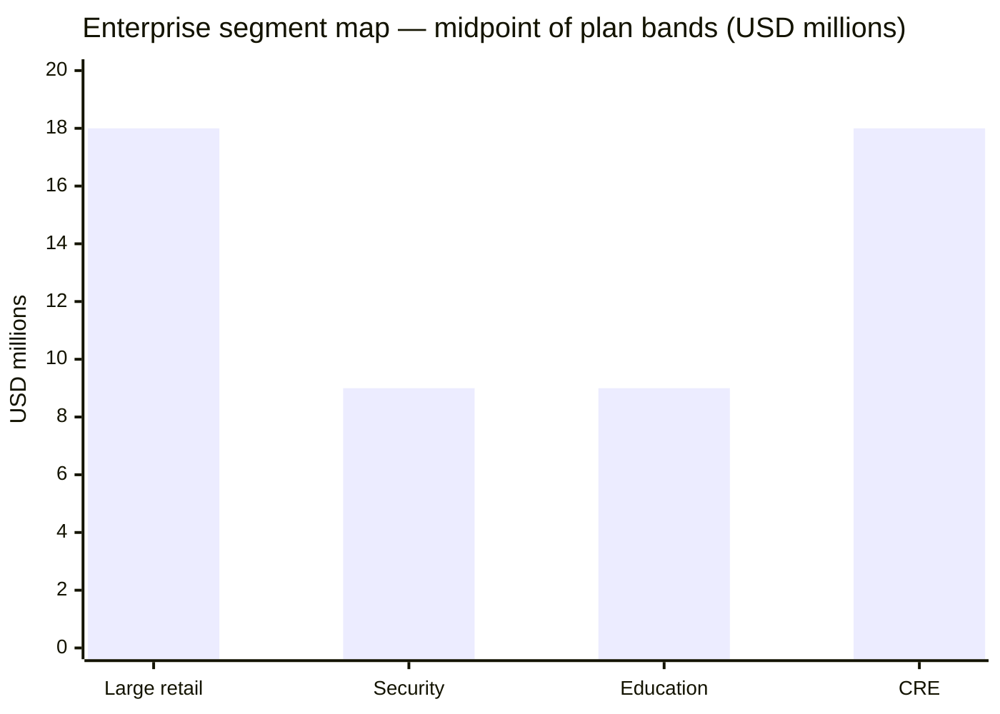
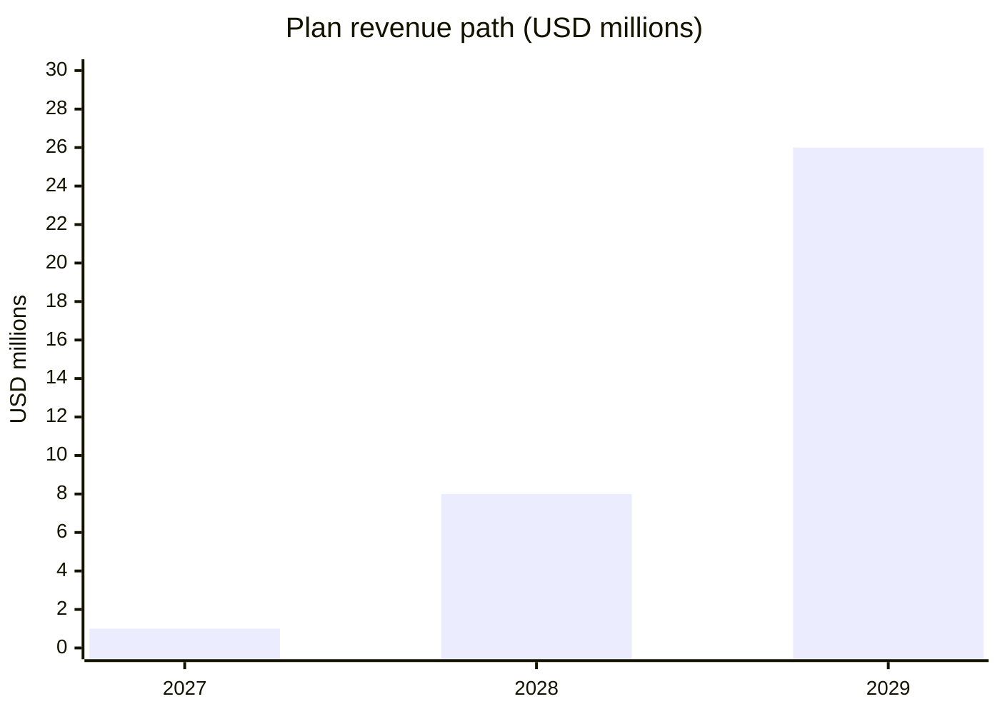

# Pricing and Revenue Estimations

**Sources (`invest/` only)**

| Content | Path |
|---------|------|
| Packages, pricing, unit economics, TAM share | `invest/how-it-is-sold/index.html` |
| Print mirror (same commercial section) | `invest/print/index.html` |
| Growth path revenue · customer counts | `invest/addendum-a/index.html` |
| Seed ARR milestones | `invest/seed-ladder/index.html` |
| Addressable-pocket counts | `invest/addendum-b/index.html` (refs cited from How it is sold) |

**Rule.** All package prices, unit-economics tags, TAM bands, and plan revenue years below are taken from `invest`. Where a split or ARPU is **computed** from those figures, it is labeled **derived**.

**Model caveat (How it is sold):** CAC, LTV, and payback are plan models (not yet cohort-backed). B2C assumes ~$50 blended MRR, low digital CAC via freemium, and multi-year retention; Enterprise LTV ~$144K is ACV × modeled tenure. Treat LTV:CAC as directional underwriting inputs.

---

## 1. Executive snapshot

Three motions on one platform — **unit economics hold across seed capital scenarios**.

| Motion | How sold | Price band | Core unit economics |
|--------|----------|------------|---------------------|
| **B2C Light** | Freemium → self-serve | $20–$300/mo · events $200–$1,200 | Avg MRR ~$50 · CAC $20–30 · LTV:CAC ~30:1 · payback 1–2 mo |
| **B2B Starter / Pro** | Sales-assisted SaaS | $500–$3,000/mo · ACV ~$12–36K/yr | Retention 85–90% · CAC payback ~3–4 mo |
| **Enterprise** | Strategic accounts | $5,000+/mo · contracts $6K–$150K+/yr | LTV ~$144K · CAC $3–5K · LTV:CAC ~40:1 |

**Plan revenue path (Addendum A):** ~$1M (2027) → ~$8M (2028) → ~$26M (2029), with exit target $500M–$1B (2030–2031).

---

## 2. Commercial package pricing

### 2.1 B2C Light

| SKU | Price | Buyer |
|-----|------:|-------|
| Signage Lite | $30–$100/mo | Marketing consultants, small agencies |
| Home Security Lite | $20–$50/mo | Homeowners, small property managers |
| Retail Compliance Lite | $50–$100/mo | Small retail, bars, restaurants |
| Event Security Lite | $200–$1,200/event | Contractors, venue managers |
| Band (overall) | $20–$300/mo | Freemium + self-serve |
| Funnel | Free 60–90 days → Lite / Pro | Web signup, app-first |

**Modeled blend:** avg MRR ~$50.

```mermaid
xychart-beta
  title "B2C Lite monthly price bands (low–high, USD)"
  x-axis ["Home Sec", "Signage", "Retail Comp", "Events*"]
  y-axis "USD / mo (events = per event)" 0 --> 1200
  bar [20, 30, 50, 200]
  bar [50, 100, 100, 1200]
```

*Bars: band low · band high. Events are per-event, not monthly.*

### 2.2 B2B — Starter & Professional

| Tier | Monthly | Scope |
|------|--------:|-------|
| **Starter** | $500–$1,000 | 1–5 locations · 5 cameras · single app · basic support |
| **Professional** | $1,500–$3,000 | 5–20 locations · 25 cameras · multi-app · priority support |
| **Typical ACV path** | ~$12K–$36K/year | Per account |
| **Mobile / wearable** | +40–60% premium | Where needed |

```mermaid
xychart-beta
  title "B2B monthly price bands (USD)"
  x-axis ["Starter", "Professional"]
  y-axis "USD / month" 0 --> 3000
  bar [500, 1500]
  bar [1000, 3000]
```

*Bars: band low · band high.*

### 2.3 Enterprise

| Element | Plan figure |
|---------|-------------|
| Monthly floor | $5,000+/mo |
| Contract band | $6K–$150K+/year |
| Planned avg ACV | Often $12K–$20K+ |
| Scope | Unlimited sites / cameras · Matrix · VPN fleets · custom ERP / CRM / eHealth / SIEM |
| Verticals named | Home care / Virtual Ward, maritime, municipal, multi-brand retail |

---

## 3. Unit economics by motion

| Metric | B2C Light | B2B Starter / Pro | Enterprise |
|--------|-----------|-------------------|------------|
| Revenue unit | Avg MRR ~$50 | ACV ~$12–36K/yr | Avg ACV often $12–20K+ (band to $150K+) |
| CAC | $20–30 | (payback stated; CAC $ not separately tagged) | $3K–5K |
| LTV / ratio | LTV:CAC ~30:1 | Retention 85–90% | LTV ~$144K · LTV:CAC ~40:1 |
| Payback | 1–2 months | ~3–4 months | (implied by high LTV:CAC) |
| Motion | High volume, shorter LTV | Land-and-expand | Strategic / multi-vertical |

**Underwriting rule (seed ladder):** checks of $1M / $2.5M above burn **do not rewrite** CAC, LTV, or payback — they only buy speed.

### Derived B2C LTV sketch (from invest tags)

Invest states avg MRR ~$50 and LTV:CAC ~30:1 with CAC $20–30.

| Assumption | Low CAC | High CAC |
|------------|--------:|---------:|
| CAC | $20 | $30 |
| Implied LTV @ 30:1 | $600 | $900 |
| Months of ~$50 MRR (no discount) | 12 mo | 18 mo |

*Derived arithmetic for diligence — invest does not publish B2C tenure explicitly.*

### Derived Enterprise tenure sketch

LTV ~$144K with planned avg ACV often $12–20K+ → implied tenure ≈ $144K ÷ ACV.

| Assumed ACV | Implied tenure |
|------------:|---------------:|
| $12K | ~12 years |
| $16K | ~9 years |
| $20K | ~7.2 years |

*Derived from invest LTV and ACV tags; invest describes LTV as ACV × modeled tenure.*

---

## 4. TAM and revenue opportunity (share math)

| Segment | U.S. TAM (plan) | Target share | → Revenue opportunity |
|---------|-----------------|-------------:|----------------------:|
| B2C | $0.5–1.5B | 1–3% | ~$5–45M |
| B2B / Enterprise | $2–4B | 1–2% | ~$20–80M |

**How invest sizes (print / How it is sold):** Dollar TAM bands are conservative U.S. addressable ranges grounded in third-party category reports (Addendum B [9]–[12]). Share → revenue is plan arithmetic on those bands.

### Enterprise segment map (U.S. targets)

| Segment | Plan revenue target |
|---------|--------------------:|
| Large retail | $12–24M |
| Security agencies | $6–12M |
| Education | $6–12M |
| CRE | $12–24M |

*Midpoints derived from invest band midpoints ($12–24 → $18; $6–12 → $9).*

---

## 5. Plan revenue path and customer counts

### 5.1 Seed milestones (before scale years)

| Horizon | Commercial proof (invest) |
|---------|---------------------------|
| Base seed ($1M) in-seed | 5–10 pilots · **$50–100K ARR** · 50-lead pipeline · 2–3 partners |
| Series A language | Path toward ~200 customers (sales + marketing ramp) |

### 5.2 Growth years (Addendum A)

| Year | Revenue | B2B customers | Consumer users | Note |
|------|--------:|--------------:|---------------:|------|
| **2027** | ~$1M | 50 | ~600 | First commercial proof after seed launch of five beta-ready products |
| **2028** | ~$8M | 200 | 6,000+ | Breakeven; capital above burn accelerates arrival |
| **2029** | ~$26M | 500 | 20,000+ | Solidly profitable on the three motions |
| **2030–2031** | — | — | — | Exit $500M–$1B (plan target) |

```mermaid
xychart-beta
  title "Plan customer counts"
  x-axis ["2027", "2028", "2029"]
  y-axis "Count" 0 --> 20000
  bar [50, 200, 500]
  bar [600, 6000, 20000]
```

*Bars: B2B customers · consumer users.*

### 5.3 Derived mix check (invest revenue ÷ invest counts × B2C ~$50 MRR)

Using invest’s stated ~$50 blended B2C MRR to allocate consumer revenue, remainder to B2B/Enterprise blended ACV:

| Year | Plan revenue | B2C rev (derived: users × $50 × 12) | Residual → B2B+Ent | B2B accounts | Implied blended B2B ACV |
|------|-------------:|-----------------------------------:|-------------------:|-------------:|------------------------:|
| 2027 | $1.0M | $0.36M (600 × $600/yr) | $0.64M | 50 | **~$12.8K** |
| 2028 | $8.0M | $3.6M (6,000 × $600/yr) | $4.4M | 200 | **~$22.0K** |
| 2029 | $26.0M | $12.0M (20,000 × $600/yr) | $14.0M | 500 | **~$28.0K** |

```mermaid
xychart-beta
  title "Derived revenue mix (USD millions)"
  x-axis ["2027", "2028", "2029"]
  y-axis "USD millions" 0 --> 30
  bar [0.36, 3.6, 12]
  bar [0.64, 4.4, 14]
```

*Bars: derived B2C · derived B2B+Enterprise residual.*

**Fit to package pricing:** Implied B2B ACVs (~$13K → ~$28K) sit inside the Starter/Pro ACV path (~$12–36K) and Enterprise “often $12–20K+” band, with 2029 implying a richer mix (more Pro / Enterprise and/or wearable premiums). This is a **consistency check**, not a published invest mix table.

---

## 6. Buyer pockets (demand context)

Counts cited from How it is sold → Addendum B:

| Motion | Pocket examples (invest) |
|--------|--------------------------|
| B2C | ~52K marketing consulting · ~87M owner-occupied homes · ~0.8M Airbnb hosts · ~8K contract security · ~1.0M+ retail + ~0.6M restaurants |
| B2B Starter / Pro | ~8K contract security · ~99K public K–12 · ~38K warehousing |
| Enterprise | Large retail, security agencies, education, CRE (segment $ targets in §4) |

---

## 7. Pricing → revenue underwriting checklist

1. **Price from the shelf:** B2C Lite SKUs, B2B Starter/Pro bands, Enterprise $5K+/mo floor.  
2. **Underwrite unit economics, not seed size:** CAC / LTV / payback unchanged across $500K / $1M / $2.5M.  
3. **Seed proof:** $50–100K ARR and 5–10 pilots on the base path before scaling years.  
4. **Scale years:** Hold ~$1M / $8M / $26M with 50 → 200 → 500 B2B and 600 → 6K → 20K consumers.  
5. **TAM share:** 1–3% of B2C and 1–2% of B2B/Enterprise bands → ~$5–45M and ~$20–80M opportunities (ceiling context, not the near-term P&L).  
6. **Pressure-test:** freemium→paid conversion, B2B retention 85–90%, Enterprise CAC $3–5K, and whether blended ACV tracks the derived ~$13–28K path.

---

## 8. Appendix — master tables

### Package price card

| Package | Recurring | ACV / other | Notes |
|---------|-----------|-------------|-------|
| B2C Light | $20–$300/mo | Events $200–$1,200; avg MRR ~$50 | Free 60–90 days |
| B2B Starter | $500–$1,000/mo | Part of ~$12–36K ACV path | 1–5 sites, 5 cams |
| B2B Professional | $1,500–$3,000/mo | Part of ~$12–36K ACV path | 5–20 sites, 25 cams |
| B2B mobile/wearable | +40–60% | On applicable variants | |
| Enterprise | $5,000+/mo | $6K–$150K+/yr; avg often $12–20K+ | Unlimited scale |

### Unit economics card

| Motion | CAC | LTV / ratio | Payback / retention |
|--------|-----|-------------|---------------------|
| B2C | $20–30 | LTV:CAC ~30:1 | 1–2 mo |
| B2B | — | — | Retention 85–90% · payback 3–4 mo |
| Enterprise | $3–5K | LTV ~$144K · ~40:1 | Strategic tenure model |

### Revenue path card

| Year | Revenue | B2B | Consumers |
|------|--------:|----:|----------:|
| 2027 | ~$1M | 50 | ~600 |
| 2028 | ~$8M | 200 | 6,000+ |
| 2029 | ~$26M | 500 | 20,000+ |

---

*Source: `invest/` (How it is sold, seed-ladder, Addendum A/B, print). Derived rows are arithmetic on those figures only. Re-extract if package or growth-path numbers change.*
