# Use of Proceeds Study — Seed Ladder Funding Scenarios

**Sources (invest only)**

| Content | Path |
|---------|------|
| Seed ladder + dollar bars + speed section | `invest/seed-ladder/index.html` |
| Print mirror (§05–06, Addenda) | `invest/print/index.html` |
| Footprint by scenario | `invest/footprint/index.html` |
| Capital path + Series A language | `invest/addendum-a/index.html` |

**Scope.** Use-of-proceeds dollars, speed framework, footprint, Series A sizing language, and a derived FTE view of those dollars. Charts are Mermaid.

**FTE note.** `invest` publishes category dollars and role language (AE / SE, marketing/CAC, product finish, footprint) — not headcount or $/FTE. Section 3 applies **study planning rates** to granulate invest dollars into FTEs; those rates are assumptions of this study, not figures printed in `invest`.

---

## 1. Executive verdict

Underwrite **burn first ($500K)**, then choose how much **speed capital** to buy ($1M or $2.5M). Extra capital does **not** rewrite CAC, LTV, or payback — it buys denser GTM, pilots, and footprint, and compresses the path to Series A / exit.

| Scenario | Seed in | Use-of-proceeds dollars | Derived FTE (planning) | People $ / Non-people $ | Typical next |
|----------|--------:|-------------------------|------------------------|-------------------------|--------------|
| **Burn floor** | $500K | Pers 180 · Mkt 135 · Tech 125 · Ops 60 | **~3.3 FTE** | ~$324K / ~$176K | Series A / growth ~$700K–$1M |
| **Base** | $1M | Mkt 350 · Pers 300 · Tech 200 · Ops 150 | **~5.8 FTE** | ~$556K / ~$444K | Series A $2–3M on $8–12M pre (through H1 2027) |
| **Accelerate** | $2.5M | Mkt 850 · Pers 550 · Sales/ft 450 · Tech 400 · Ops 250 | **~13.7 FTE** | ~$1.27M / ~$1.23M | Series A still open for land-and-expand |

**Instrument:** convertible note or SAFE across scenarios. Per seed-ladder: the $1M and $2.5M figures appear in the business-plan set; treat them as **capital choices on the same ladder**, not competing truths.

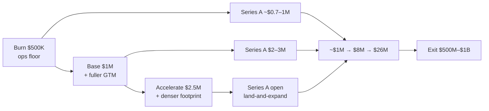

---

## 2. Use of proceeds — all seed scenarios

### 2.1 Burn floor — $500K

| Category | Amount | Share |
|----------|-------:|------:|
| Personnel | $180K | 36% |
| Marketing / CAC | $135K | 27% |
| Tech | $125K | 25% |
| Ops / R&D | $60K | 12% |
| **Total** | **$500K** | **100%** |

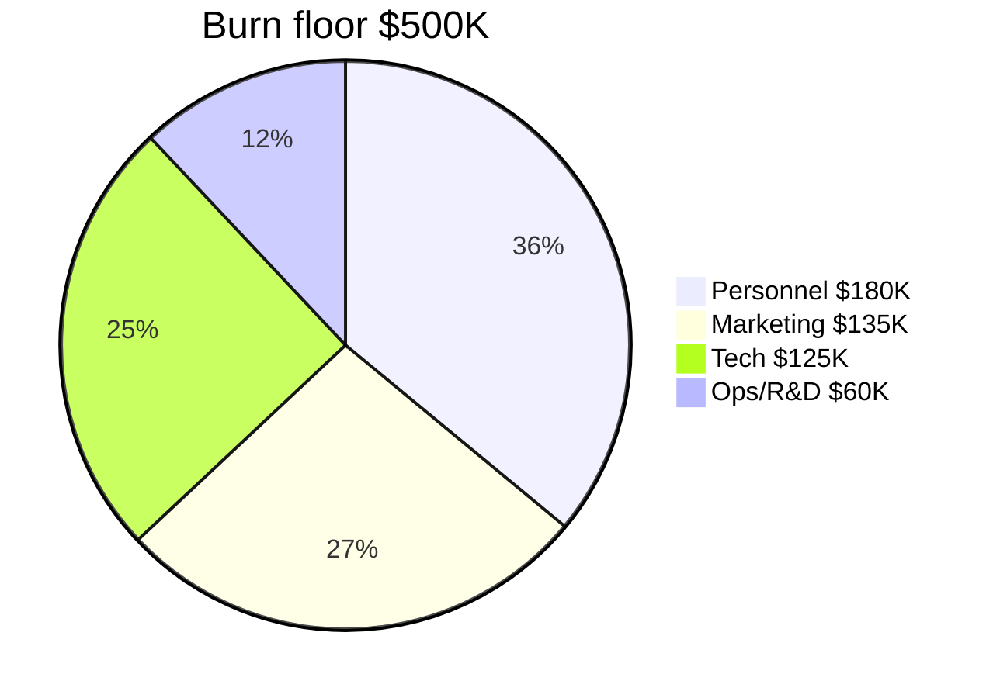

**Buys:** launch, first pilots, lean runway. Greek unit as EU pilot (GDPR-first, lean team); lean commercial start in the U.S.  
**Speed layer:** none — ops only.

---

### 2.2 Base seed — $1M

| Category | Amount | Share |
|----------|-------:|------:|
| Marketing | $350K | 35% |
| Personnel | $300K | 30% |
| Tech | $200K | 20% |
| Ops / R&D | $150K | 15% |
| **Total** | **$1,000K** | **100%** |

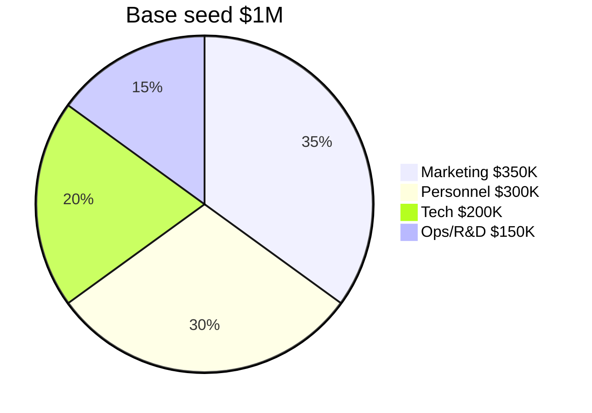

**Buys:** burn covered + fuller GTM.  
**Terms:** ~25% at $3M pre ($4M post).  
**In-seed proof:** 5–10 pilots · $50–100K ARR · 50-lead pipeline · 2–3 partners.  
**Footprint:** formal Greek + U.S. business units.  
**Next:** Series A $2–3M on $8–12M pre (target window through **H1 2027**).

---

### 2.3 Accelerate seed — $2.5M

| Category | Amount | Share |
|----------|-------:|------:|
| Marketing | $850K | 34% |
| Personnel | $550K | 22% |
| Sales / footprint | $450K | 18% |
| Tech | $400K | 16% |
| Ops / R&D | $250K | 10% |
| **Total** | **$2,500K** | **100%** |

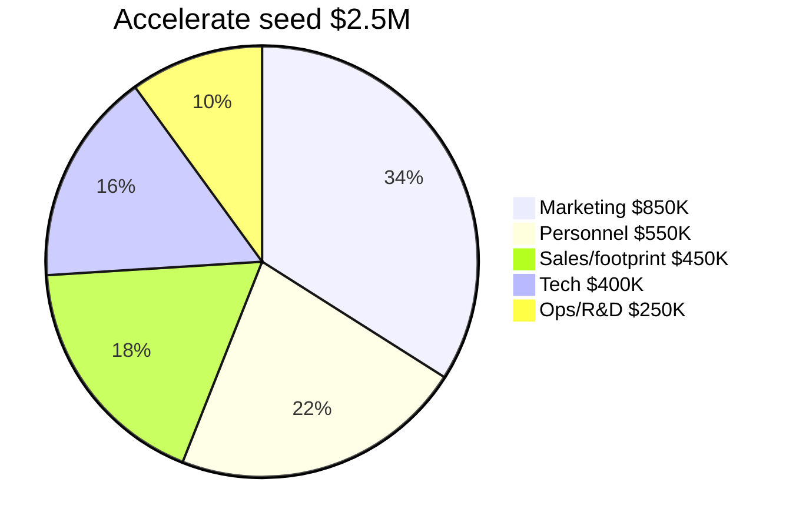

**Buys:** same core economics, earlier scale — denser sales/marketing + multi-site footprint in-seed; London representation (UK / North-West Europe; **not** a second R&D center).  
**Next:** Series A still available for land-and-expand; larger seed compresses time to that raise.

---

### 2.4 Ladder comparison

```mermaid
xychart-beta
  title "Use of proceeds by category (USD thousands)"
  x-axis ["Personnel", "Marketing", "Tech", "Ops/R&D", "Sales/footprint"]
  y-axis "USD thousands" 0 --> 900
  bar [180, 135, 125, 60, 0]
  bar [300, 350, 200, 150, 0]
  bar [550, 850, 400, 250, 450]
```

*Bars: Burn $500K · Base $1M · Accelerate $2.5M. Sales/footprint appears only on Accelerate.*

| Category | Burn $500K | Base $1M | Accelerate $2.5M | Burn→Base Δ | Base→Accel Δ |
|----------|----------:|---------:|-----------------:|------------:|-------------:|
| Personnel | 180 | 300 | 550 | +120 | +250 |
| Marketing | 135 | 350 | 850 | +215 | +500 |
| Tech | 125 | 200 | 400 | +75 | +200 |
| Ops / R&D | 60 | 150 | 250 | +90 | +100 |
| Sales / footprint | — | — | 450 | — | +450 |
| **Total** | **500** | **1,000** | **2,500** | **+500** | **+1,500** |

**Pattern:** Marketing becomes the peak bucket at Base and Accelerate. Accelerate uniquely adds a **Sales / footprint** line ($450K). Personnel and tech scale up, but marketing absorbs the largest absolute increments.

---

## 3. FTE granulation (planning rates × invest dollars)

### 3.1 Standard fully-loaded cost per FTE (study planning rates)

| Role family | Planning rate / FTE / yr | Maps to invest language |
|-------------|-------------------------:|-------------------------|
| Sales & BD | **$82K** | AE / SE / partner capacity; Sales / footprint |
| Marketing (people) | **$76K** | Marketing / CAC (people portion) |
| Product & Engineering | **$109K** | Product finish; Tech |
| Customer Success | **$83K** | Customer success / pilots |
| Operations & Finance | **$100K** | Ops / R&D; footprint stand-up support |

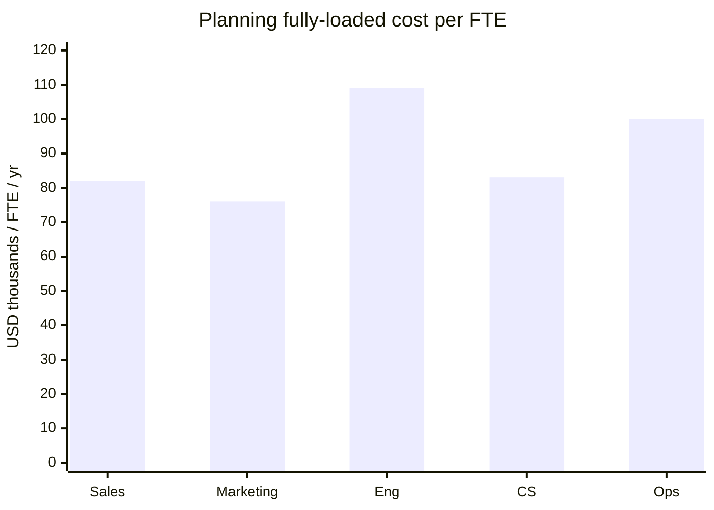

### 3.2 People vs non-people split (planning)

Splits keep invest category totals exact while mapping speed-bucket language onto FTEs. Not printed as percentages in `invest`.

| Invest bucket | People share | Non-people share | Non-people examples (from speed / footprint text) |
|---------------|-------------:|-----------------:|-----------------------------------------------------|
| Personnel | **100%** | 0% | — |
| Marketing | **~25%** (burn/base) · **~18%** (accelerate) | Remainder | CAC / demand programs (marketing/CAC bucket) |
| Tech | **~60%** | ~40% | Edge-kit / tooling / contractors |
| Ops / R&D | **~50%** | ~50% | Legal, compliance, entity, R&D materials |
| Sales / footprint | **~55%** | ~45% | Greek / U.S. / London stand-up, travel, partner enablement |

### 3.3 Burn floor — $500K → ~3.3 FTE

| Role | FTE | Rate | Cost | Invest bucket |
|------|----:|-----:|-----:|---------------|
| Product & Engineering | 1.0 | $109K | $109K | Personnel |
| Sales & BD | 0.5 | $82K | $41K | Personnel |
| Operations & Finance | 0.3 | $100K | $30K | Personnel |
| Marketing (people) | 0.5 | $76K | $38K | Marketing |
| Product & Engineering | 0.7 | $109K | $76K | Tech |
| Operations & Finance | 0.3 | $100K | $30K | Ops / R&D |
| **People subtotal** | **3.3** | | **$324K** | |
| Marketing / CAC programs | — | — | $97K | Marketing residual ($135 − $38) |
| Tech infra / contractors | — | — | $49K | Tech residual ($125 − $76) |
| Ops legal / tools / R&D | — | — | $30K | Ops residual ($60 − $30) |
| **Non-people subtotal** | | | **$176K** | |
| **Scenario total** | | | **$500K** | |

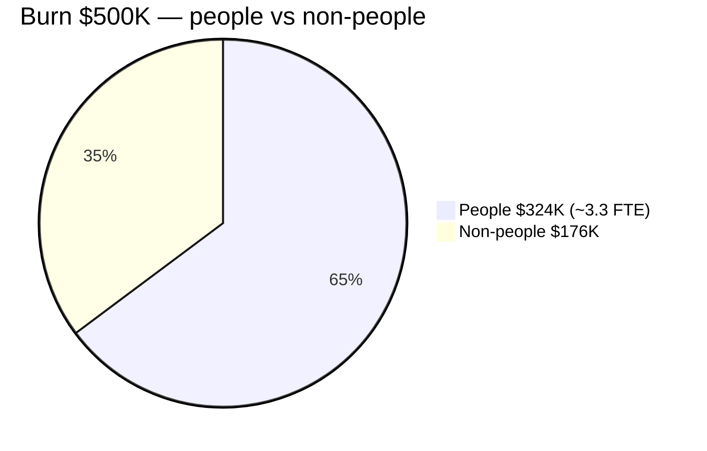

### 3.4 Base seed — $1M → ~5.8 FTE

| Role | FTE | Rate | Cost | Invest bucket |
|------|----:|-----:|-----:|---------------|
| Product & Engineering | 1.5 | $109K | $164K | Personnel |
| Sales & BD | 1.0 | $82K | $82K | Personnel |
| Operations & Finance | 0.5 | $100K | $50K | Personnel |
| *Personnel subtotal* | *3.0* | | *$296K* | *+$4K plug → $300K* |
| Marketing (people) | 1.0 | $76K | $76K | Marketing |
| Product & Engineering | 1.0 | $109K | $109K | Tech |
| Operations & Finance | 0.75 | $100K | $75K | Ops / R&D |
| **People subtotal** | **5.75 (~5.8)** | | **$556K** | |
| Marketing / CAC programs | — | — | $274K | Marketing ($350 − $76) |
| Tech infra / contractors | — | — | $91K | Tech ($200 − $109) |
| Ops / entity / R&D | — | — | $75K | Ops ($150 − $75) |
| Personnel rounding plug | — | — | $4K | Aligns Personnel to $300K |
| **Non-people + plug** | | | **$444K** | |
| **Scenario total** | | | **$1,000K** | |

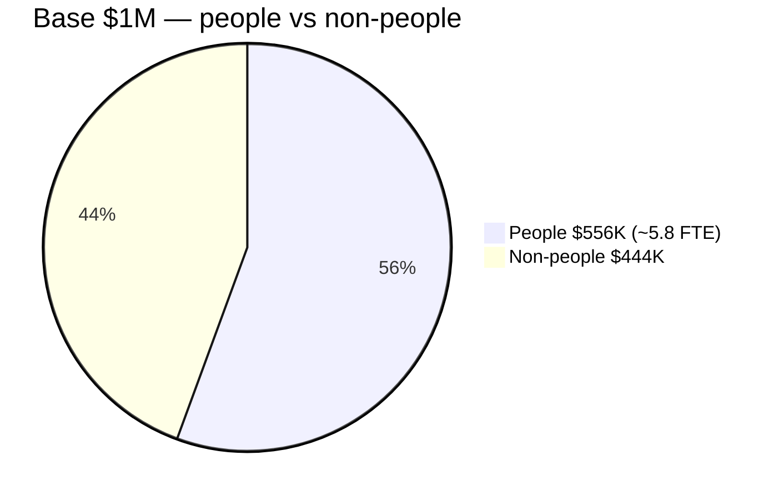

### 3.5 Accelerate seed — $2.5M → ~13.7 FTE

| Role | FTE | Rate | Cost | Invest bucket |
|------|----:|-----:|-----:|---------------|
| Product & Engineering | 2.5 | $109K | $273K | Personnel |
| Sales & BD | 1.5 | $82K | $123K | Personnel |
| Customer Success | 1.0 | $83K | $83K | Personnel |
| Operations & Finance | 0.7 | $100K | $70K | Personnel |
| *Personnel subtotal* | *5.7* | | *$549K* | *+$1K plug → $550K* |
| Marketing (people) | 2.0 | $76K | $152K | Marketing |
| Sales & BD (AE / SE / partner) | 3.0 | $82K | $246K | Sales / footprint |
| Product & Engineering | 2.0 | $109K | $218K | Tech |
| Operations & Finance | 1.0 | $100K | $100K | Ops / R&D |
| **People subtotal** | **13.7** | | **$1,265K** | |
| Marketing / CAC programs | — | — | $698K | Marketing ($850 − $152) |
| Footprint stand-up (GR / US / London) | — | — | $204K | Sales/footprint ($450 − $246) |
| Tech infra / contractors | — | — | $182K | Tech ($400 − $218) |
| Ops / legal / entity / R&D | — | — | $150K | Ops ($250 − $100) |
| Personnel rounding plug | — | — | $1K | Aligns Personnel to $550K |
| **Non-people + plug** | | | **$1,235K** | |
| **Scenario total** | | | **$2,500K** | |

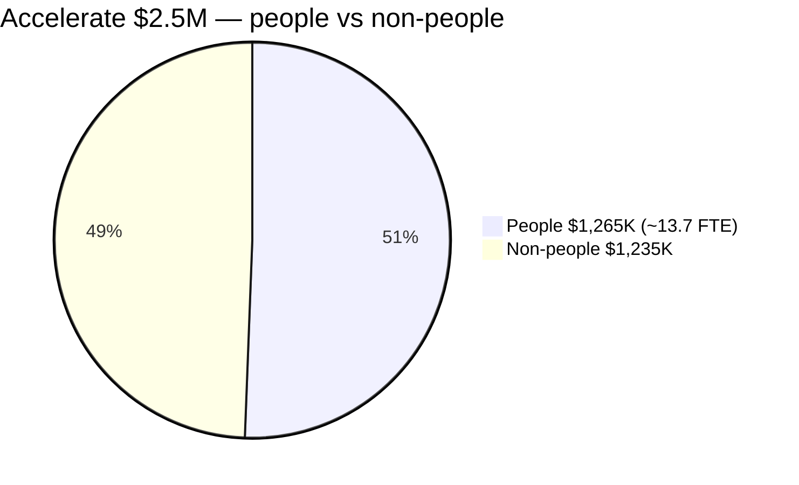

### 3.6 FTE rollup across the ladder

| Role family | Burn FTE | Base FTE | Accelerate FTE | Rate |
|-------------|---------:|---------:|---------------:|-----:|
| Product & Engineering | 1.7 | 2.5 | 4.5 | $109K |
| Sales & BD | 0.5 | 1.0 | 4.5 | $82K |
| Marketing (people) | 0.5 | 1.0 | 2.0 | $76K |
| Customer Success | — | — | 1.0 | $83K |
| Operations & Finance | 0.6 | 1.25 | 1.7 | $100K |
| **Total FTE** | **3.3** | **5.75** | **13.7** | |
| People $ | $324K | $556K | $1,265K | |
| Non-people $ | $176K | $444K | $1,235K | |
| **Invest total** | **$500K** | **$1,000K** | **$2,500K** | |

```mermaid
xychart-beta
  title "Derived FTE by role family across seed ladder"
  x-axis ["Eng", "Sales", "Marketing", "CS", "Ops"]
  y-axis "FTE" 0 --> 5
  bar [1.7, 0.5, 0.5, 0, 0.6]
  bar [2.5, 1.0, 1.0, 0, 1.25]
  bar [4.5, 4.5, 2.0, 1.0, 1.7]
```

*Bars: Burn · Base · Accelerate.*

**Gross capacity ceiling** (if a bucket were 100% people — not the planning view):

| Bucket | Burn | Base | Accelerate | Rate |
|--------|-----:|-----:|-----------:|------|
| Personnel @ blended ~$95K | ~1.9 | ~3.2 | ~5.8 | Blended |
| Marketing @ $76K | ~1.8 | ~4.6 | ~11.2 | Ceiling only (would erase CAC) |
| Tech @ $109K | ~1.1 | ~1.8 | ~3.7 | Ceiling only |
| Ops @ $100K | 0.6 | 1.5 | 2.5 | Ceiling only |
| Sales/ft @ $82K | — | — | ~5.5 | Ceiling only |

Planning rosters use the **people/non-people splits in §3.2**, not the gross ceiling.

---

## 4. Use of proceeds — speed framework

Capital above burn is framed as **speed**, not a new business model.

| Bucket | What speed buys | Why it matters |
|--------|-----------------|----------------|
| Sales coverage | More AE / SE / partner capacity | Parallel pilots, not sequential |
| Marketing / CAC | Higher qualified-lead throughput | 50-lead pipeline earlier · consumer + mid-market volume |
| Customer success / pilots | Faster deploy-to-value on any-camera installs | Compresses first detection into paid logos |
| Product finish | Sentinel + packaging for the five beta products | Removes ship blockers without changing the wedge |
| Footprint stand-up | Formal Greek + U.S. units · London only on $2.5M | Multi-site presence inside the seed window |
| Working capital | Edge-kit buffer · enterprise cycle cover | Keeps land-and-expand from stalling |

| Scenario | Speed spend | In-seed proof |
|----------|-------------|---------------|
| $500K burn | Ops only — no acceleration layer | Launch · first pilots · lean runway |
| $1M base | Burn covered + fuller GTM | 5–10 pilots · $50–100K ARR · 50-lead pipeline · 2–3 partners |
| $2.5M accelerate | Denser sales / marketing + multi-site footprint | Same economics · compressed Series A window · London rep |

**Will not fund:** cloud-VMS rebuild · proprietary camera estate · second R&D center · per-camera license chase.

**Speed KPIs:** pilots / ARR / pipeline earlier · 2–3 partners live sooner · U.S. + EU units in-seed · Series A window compressed · path toward ~200 customers / breakeven trajectory.

### Footprint steps

| Step | Burn $500K | Base $1M | Accelerate $2.5M |
|------|------------|----------|------------------|
| 1 · Greek unit | Yes — EU pilot, GDPR-first, lean | Yes — formal Greek BU | Yes — EU operating base |
| 2 · U.S. business unit | Lean commercial start | Yes — enterprise + B2C | Yes — denser sales + partners |
| 3 · London office | — | — | Yes — UK / NW Europe representation |

---

## 5. Series A (post-seed)

`invest` does **not** publish a Series A dollar pie. Size and timing **scale with seed choice**:

| After seed | Series A | Use of proceeds language |
|------------|----------|--------------------------|
| Burn $500K | ~$700K–$1M after traction | Not itemized |
| Base $1M | $2–3M on $8–12M pre (through H1 2027) | Not itemized |
| Accelerate $2.5M | Still open; compressed timing | Dedicated sales, marketing ramp, path toward ~200 customers |

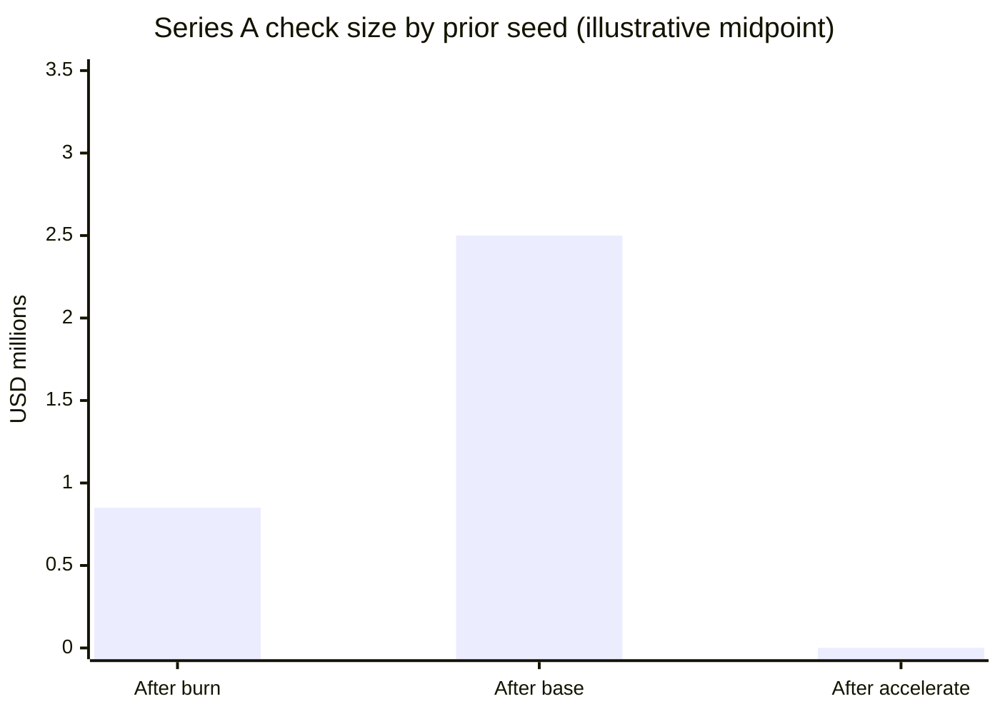

*After accelerate = 0 on the chart because the ask is left open (land-and-expand), not a fixed midpoint.*

Growth path (Addendum A / print): ~$1M · 50 B2B (2027) → ~$8M · 200 B2B (2028) → ~$26M · 500 B2B (2029) → exit $500M–$1B (2030–2031).

---

## 6. Underwriting playbook

1. **Underwrite $500K** with the four-bucket burn split → **~3.3 FTE** at planning rates + ~$176K non-people.  
2. **Choose speed:** $1M (~**5.8 FTE**, heavier CAC) or $2.5M (~**13.7 FTE**, +3 Sales/footprint FTEs + London OpEx).  
3. **Hold unit economics constant** across rungs; measure speed KPIs, not a new CAC story.  
4. **Price headcount** with §3.1 rates ($82 / $76 / $109 / $83 / $100K); do not treat Marketing or Tech buckets as 100% people.  
5. **Size Series A from the seed chosen** (~$0.7–1M / $2–3M / open).

---

## 7. Appendix — source anchors & master tables

| Content | Canonical location |
|---------|-------------------|
| Seed ladder + dollar bars | `invest/seed-ladder/index.html` |
| Same bars + speed section (print) | `invest/print/index.html` §05 |
| Footprint by scenario | `invest/footprint/index.html` / print §06 |
| Capital path + Series A language | `invest/addendum-a/index.html` / print Addendum A |
| Ladder provenance (footer) | Print/footprint footer: burn ($500K), print plan & exec summary ($1M), HTML investor page ($2.5M) — staged into one ladder |

### Master dollar table

| Scenario | Pers. | Mkt | Tech | Ops | Sales/ftprnt | Total |
|----------|------:|----:|-----:|----:|-------------:|------:|
| Burn $500K | 180 | 135 | 125 | 60 | — | **500** |
| Base $1M | 300 | 350 | 200 | 150 | — | **1,000** |
| Accelerate $2.5M | 550 | 850 | 400 | 250 | 450 | **2,500** |

*USD thousands. Source: `invest/seed-ladder` / `invest/print`.*

### Master FTE table (derived)

| Scenario | Eng | Sales | Mkt people | CS | Ops | **FTE** | People $ | Non-people $ |
|----------|----:|------:|-----------:|---:|----:|--------:|---------:|-------------:|
| Burn $500K | 1.7 | 0.5 | 0.5 | — | 0.6 | **3.3** | $324K | $176K |
| Base $1M | 2.5 | 1.0 | 1.0 | — | 1.25 | **5.75** | $556K | $444K |
| Accelerate $2.5M | 4.5 | 4.5 | 2.0 | 1.0 | 1.7 | **13.7** | $1,265K | $1,235K |

---

*Dollars and narrative: `invest/` only. FTE rosters = planning rates × invest dollars. Re-extract if seed-ladder or print proceeds bars change.*
